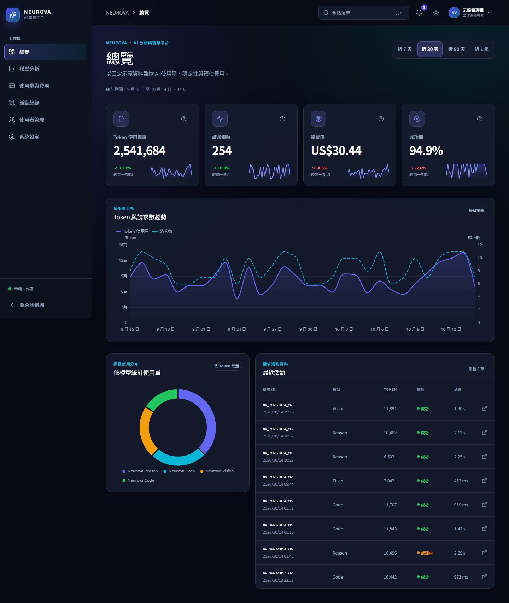

# NEUROVA

**AI Analytics & Intelligence Platform**

NEUROVA 是一個以 Vue 3 與 TypeScript 製作的純前端 AI 分析管理平台示範專案。介面使用繁體中文，展示資料視覺化、可查詢的活動紀錄、前端使用者管理，以及兼顧桌機與手機的 SaaS 操作體驗。

> 這是前端工程師作品集，不是真實營運服務。所有請求、費用、帳號與通知皆為示範資料；沒有後端 API、資料庫、登入或真正的權限驗證。

## 專案畫面



| 頁面 | 桌機截圖 |
| --- | --- |
| 總覽 | [查看](docs/screenshots/overview-desktop.png) |
| 模型分析 | [查看](docs/screenshots/model-analytics-desktop.png) |
| 使用量與費用 | [查看](docs/screenshots/usage-billing-desktop.png) |
| 活動紀錄 | [查看](docs/screenshots/activity-logs-desktop.png) |
| 使用者管理 | [查看](docs/screenshots/users-desktop.png) |
| 系統設定 | [查看](docs/screenshots/settings-desktop.png) |

手機版：[總覽](docs/screenshots/overview-mobile.png) · [活動紀錄](docs/screenshots/activity-logs-mobile.png) · [使用者管理](docs/screenshots/users-mobile.png)（390px）

截圖取自專案的正式建置預覽，使用固定示範資料；畫面中的日期、數值、使用者與費用並非真實服務紀錄。

## 核心功能

| 頁面 | 內容 |
| --- | --- |
| 總覽 Dashboard | 依日期範圍計算的 KPI、Token 與請求趨勢、模型使用分布及最近活動。 |
| 模型分析 Model Analytics | 模型 KPI、可排序比較表、可切換模型的趨勢圖與詳情 Dialog。 |
| 使用量與費用 Usage & Billing | 使用量與預估費用趨勢、模型費用分布、可排序及分頁的每日彙總、CSV 匯出。 |
| 活動紀錄 Activity Logs | 示範請求事件的搜尋、模型／狀態／事件類型篩選、分頁、詳情與 CSV 匯出。 |
| 使用者管理 User Management | 前端模擬的新增、編輯、啟用／停用、刪除、驗證、搜尋、篩選、排序與分頁。 |
| 系統設定 System Settings | 顯示名稱、深色／淺色／跟隨系統主題、通知類別、減少動畫及示範資料重設。 |

共用功能包括全站搜尋（點擊頁首搜尋或按 `Ctrl + K`；macOS 為 `Cmd + K`）、固定示範通知與已讀狀態、7／30／90 天及 1 年日期範圍、深淺色主題、ECharts 圖表、載入與空資料狀態。全站搜尋僅導向已實作的頁面與功能入口，**不搜尋未建立索引的資料內容**。

## 技術架構

- **前端：**Vue 3、TypeScript、Vite、Vue Router、Pinia。
- **介面：**Tailwind CSS v4、專案 Design Tokens、`@lucide/vue`。
- **圖表：**Apache ECharts；分析頁與圖表元件採動態載入。
- **品質驗證：**Vitest、Playwright。

本專案沒有引入後端、外部 AI API 或付費服務。費用只是依示範定價計算的**預估費用**，並非帳單。

## 本機執行

此專案使用 Vite 8；依目前鎖定版本的需求，請使用 **Node.js `^20.19.0 || >=22.12.0`**，並保留 `package-lock.json` 以重現安裝結果。

```sh
npm ci
npm run dev
```

開發伺服器網址以終端機顯示為準。建立並預覽正式版本：

```sh
npm run build
npm run preview
```

## 測試

```sh
npm run build
npm run test
npx playwright install chromium
npm run test:e2e
```

`npm run build` 包含 TypeScript 檢查與正式建置；`npm run test` 執行 Vitest；`npm run test:e2e` 執行 Playwright 瀏覽器測試。第一次執行 E2E 前須安裝 Playwright 使用的 Chromium。E2E 會依 `playwright.config.ts` 啟動本機開發伺服器。

## 專案目錄

```text
src/
├── components/    # Layout、圖表、表格、Dialog 與共用介面元件
├── composables/   # 捲動鎖定、焦點管理、動畫偏好等共用邏輯
├── mocks/         # 固定且可重現的 AI 請求與示範使用者資料
├── router/        # 六個主要頁面的路由
├── services/      # ECharts 模組註冊
├── stores/        # Pinia 狀態與本機偏好
├── styles/        # Design Tokens 與共用樣式
├── types/         # TypeScript 資料型別
├── utils/         # 統計、篩選、CSV 與驗證函式及單元測試
└── views/         # 六個主要頁面
e2e/              # Playwright 回歸測試
design-system/    # 設計規範
docs/screenshots/ # 實際執行畫面截圖
```

## RWD 與無障礙設計

桌機使用 Sidebar 與表格，手機改用導覽 Drawer、卡片式資料列表及適合窄螢幕的控制項。專案涵蓋 320、375、390、768、1024、1440px 的響應式測試。Dialog 與行動 Drawer 支援 Esc、焦點限制、關閉後焦點回復及背景捲動鎖定；表單有標籤與驗證回饋，狀態不只依賴顏色。介面尊重系統 `prefers-reduced-motion`，也提供本機「減少動畫效果」設定。

## 示範資料與保存方式

AI 分析使用固定種子產生的 420 天 Mock Data；示範使用者初始為 72 筆，與 AI 請求事件沒有真實帳號關聯。日期範圍切換只改變示範資料的統計口徑。使用量與活動 CSV 匯出的是符合目前篩選條件的示範資料，不是真實帳單或 API 日誌。

主題、顯示名稱、通知偏好與已讀狀態，以及使用者管理的模擬 CRUD，部分儲存在**目前瀏覽器的 `localStorage`**；清除瀏覽器資料或改用其他裝置不會同步。請勿在示範表單輸入真實個資或機密內容。

## 已知限制與作品集定位

- 沒有真正的登入、RBAC、後端持久化、即時通知、付款或 AI 模型連線；前端確認操作不會變更真實帳號或服務權限。
- 固定示範日期與定價使結果可重現，不能代表即時使用量或實際花費。
- 正式建置仍會提示 ECharts Chunk 超過 500 kB；圖表依頁面載入，非分析頁不會下載 ECharts。此警告不影響目前建置與測試。

這份作品著重展示 Vue／TypeScript 架構、可重現的資料處理、資料視覺化、複雜前端互動、RWD、鍵盤無障礙與自動化測試；所有示範性質均在介面與文件中明確標示。
